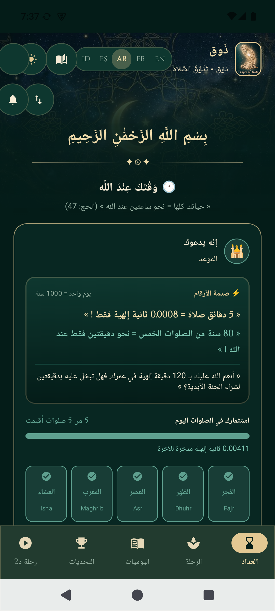
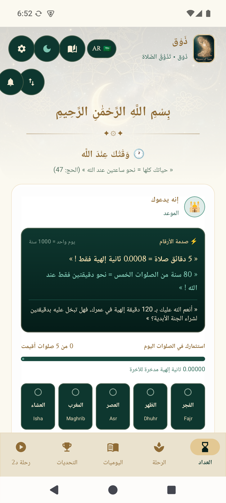
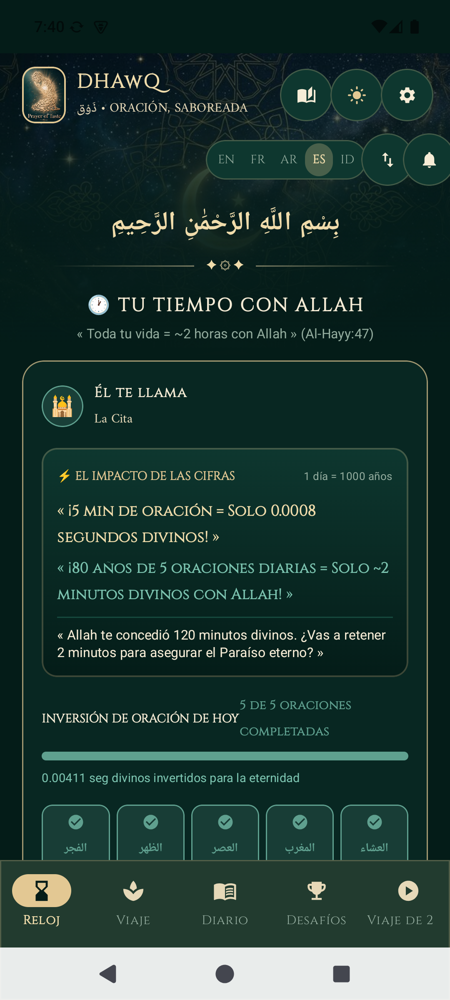
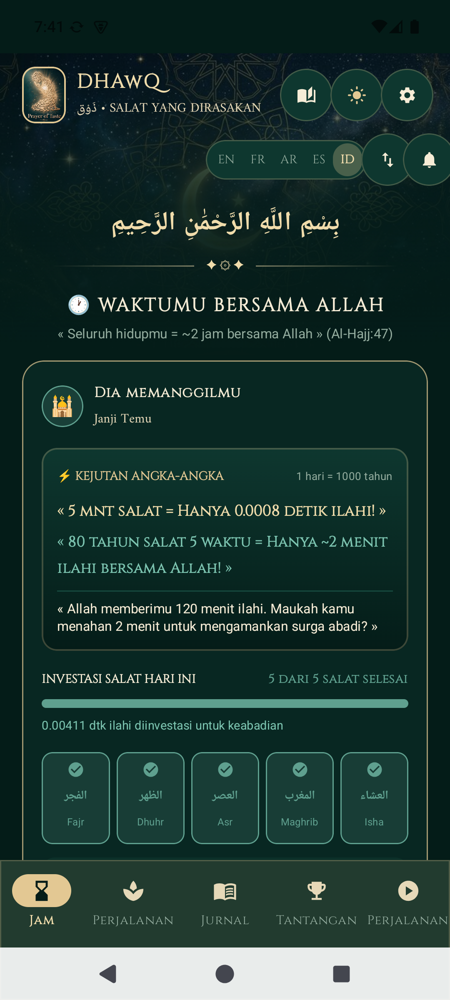
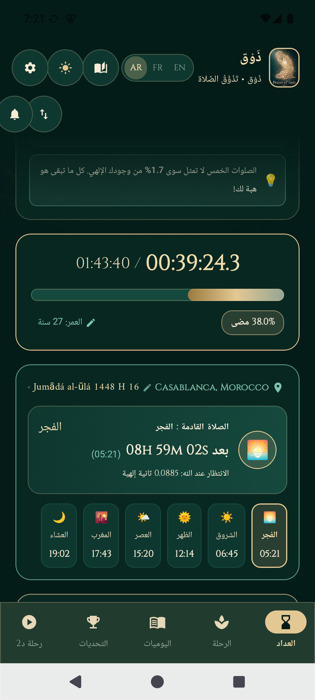
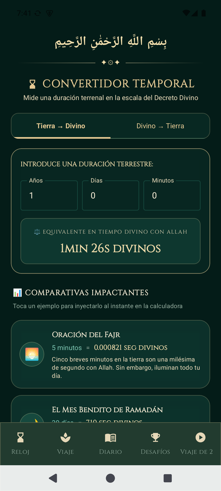
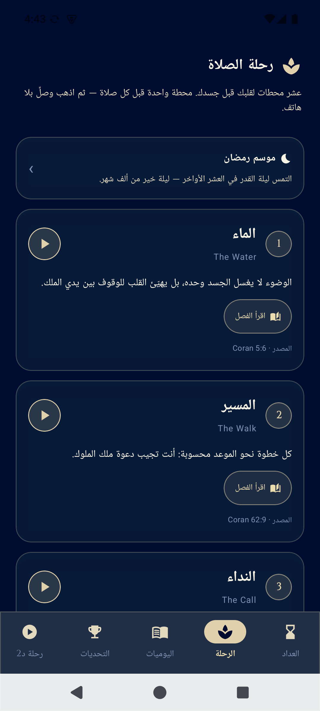
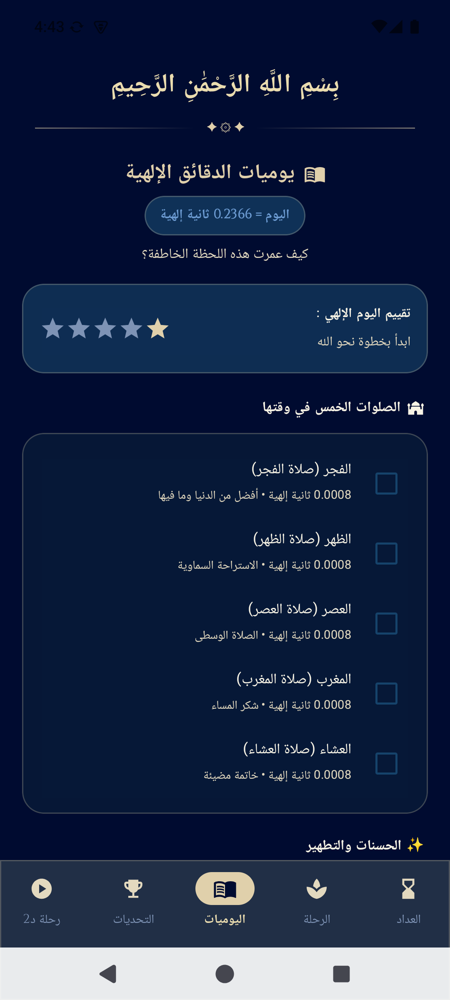
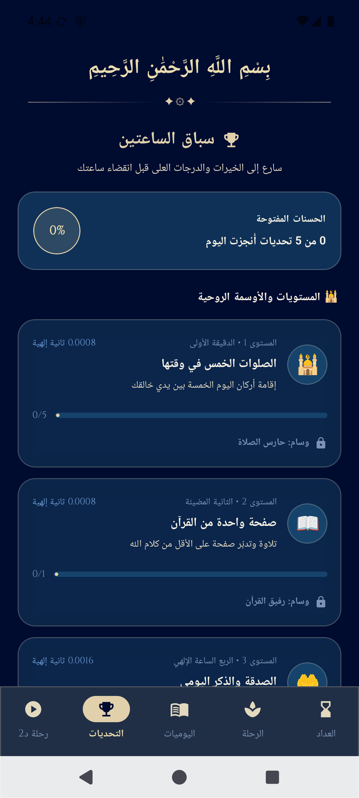
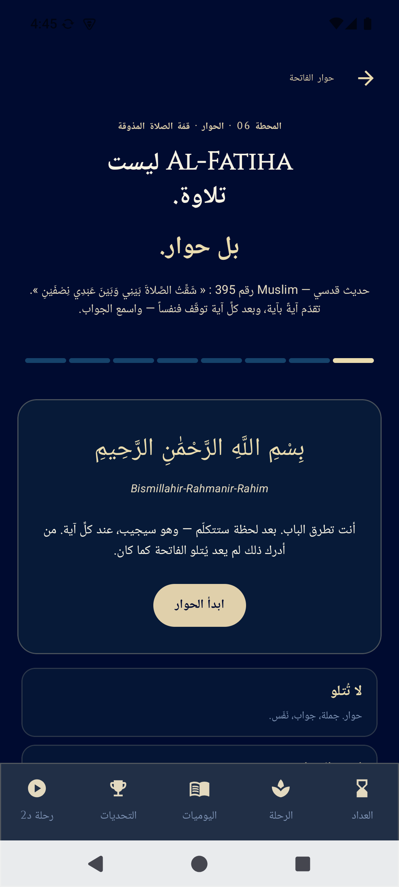

# Dhawq — ذَوْق · La Prière Goûtée

**Dhawq** (« le goût ») est une application Android qui remet la prière à l'échelle de l'éternité : toute une vie humaine (~83 ans) n'y représente que **2 heures divines** auprès d'Allah. Chaque « goûter » la prière devient une question concrète : *que fais-tu de ta seconde divine ?*

> « Et un jour auprès de ton Seigneur équivaut à mille ans de ce que vous comptez. » — Coran 22:47

Base calibrée par l'application : 1 seconde divine ≈ 4,23 jours terrestres · 5 prières/journal sur 80 ans ≈ **2 minutes divines** (1,7 % de la vie).

---

## Fonctionnalités

- ⏳ **Horloge divine** — compteur de vie en temps divin (heures/minutes/secondes), jalon par jalon : naissance, taklif, maturité, sagesse, grand retour.
- 🕌 **Horaires de prière** — API Aladhan, sélecteur de ville avec recherche parmi ~224 pays (15 épinglés en tête), persistance de la dernière localisation (Room v5), rappels Fajr/Dhuhr/vendredi armés sur les horaires réels.
- 📖 **Le voyage (10 stations)** — une station avant chaque prière ; audio par langue (arabe natif, anglais, français ; espagnol/indonésien en fallback anglais en attendant l'enregistrement), chapitres du livre tissés dedans.
- 🗣 **Le dialogue d'Al-Fatiha** (station 06) — verset par verset, hadith qudsi Muslim n°395 : *« J'ai divisé la prière entre Moi et Mon serviteur, en deux moitiés. »*
- 📔 **Journal des minutes divines** — les 5 prières du jour, les bonnes œuvres, le tasbih, l'investissement spirituel du jour.
- 🏆 **Défis & niveaux** — hassanat, badges, régularité.
- ⚖ **Convertisseur temporel** — terre → divin et divin → terre, avec benchmarks choc (3 h d'écran/jour = 15 minutes divines de vie).
- 🌙 **Ramadan** — les 10 dernières nuits, Laylatul Qadr, veille qiyam.
- 🌗 **Thèmes jour/nuit** — nuit té+or, jour parchemin, contrastes AA.

## 5 langues d'interface

Arabe (RTL natif) · Français · English · Español · Bahasa Indonesia — sélecteur instantané dans l'en-tête, terminologie islamique conservée par convention (salat, hassanat, taklif). Catalogue centralisé de ~450 clés (`AppStrings.kt`).

## Technique

- **Kotlin · Jetpack Compose** (Material 3, designs vectoriels, zéro image de layout codée en dur)
- **Room v5** (profil, journal, cache horaires) avec migrations versionnées + schémas exportés
- **Retrofit/Aladhan** pour les horaires, fallback hors ligne
- **60 tests unitaires** (maths divines + contrat de localisation), lint 0 erreur
- Build : `./gradlew :app:assembleDebug` — aucune clé API requise (l'app ne dépend d'aucun service payant)

## Contenu & droits

- L'app s'inspire du **concept** de la série « تذوق العبادات » (Dr Ahmed Al-Arabi) — goûter les actes d'adoration — mais **ne reprend ni extraits vidéo, ni voix, ni contenus du sheikh**.
- Textes : rédaction originale ; citations coraniques et hadiths référencés (Musulman n°395, al-Bukhari, Al-Hakim…) — sources publiques du patrimoine religieux.
- La relecture théologique est cadrée (`COMITE_THEOLOGIQUE.md`) ; les scénarios voix sont décrits dans `SCENARIOS_VOIX_DHAWQ.md`. Un contact avec l'équipe du Dr Al-Arabi reste recommandé avant toute mention publique de la série.

## Docs

`AUDIT_DHAWQ_2026-10-27.md` (audit émulateur 16 points) · `FEASIBILITE_PAYS_LANGUES_2026-10-27.md` · `VISION_DHAWQ.md` · `BETA_TEST_PLAN.md`
